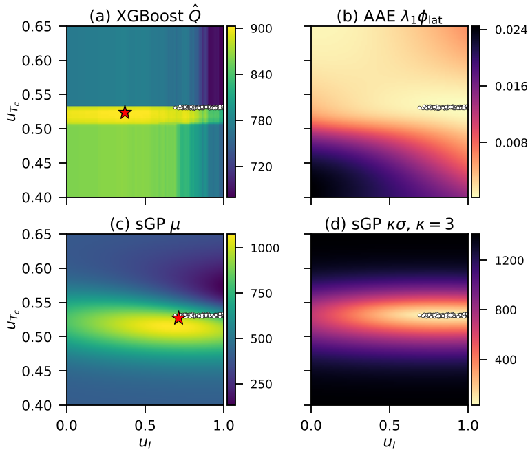
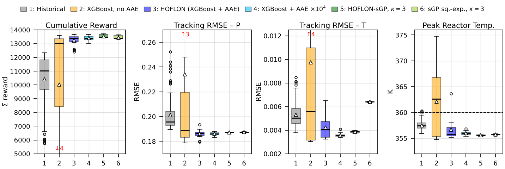
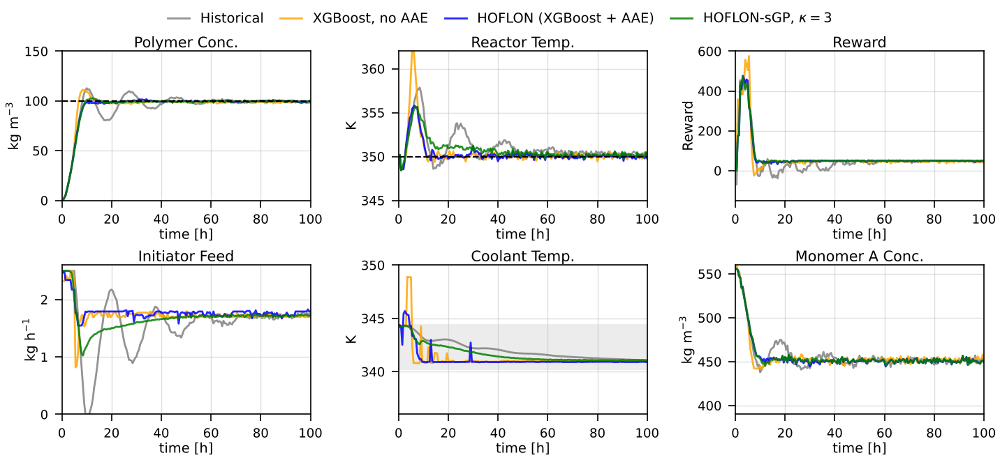
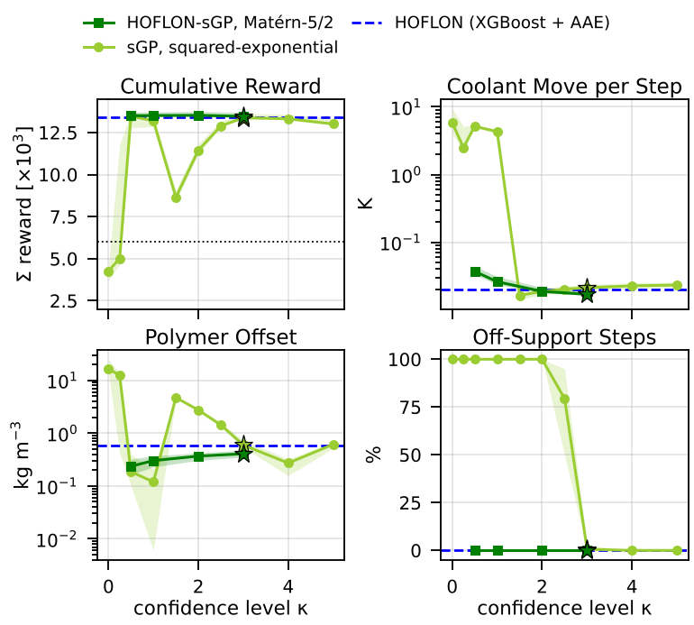

# HOFLON-sGP: Sparse Gaussian-Process Critics for Hybrid Offline–Online Start-Up Control

HOFLON-sGP replaces the critic and the adversarial-autoencoder (AAE) support penalty of
[HOFLON](https://github.com/AISL-at-Imperial-College-London/HOFLON) by one sparse variational Gaussian-process
critic. A critic regressed on the discounted returns of historical start-ups estimates the value Q_β of one move
followed by the historical operating practice. At each sampling instant the controller applies

    a_k = argmax_a  μ(s_k, a) − κ σ(s_k, a) − λ₂ ‖a − a_{k−1}‖²

that is, the lower confidence bound of the GP critic with a dimensionless confidence level κ (κ = 3 in the paper),
minus a small move penalty. The case study is the polymerisation-reactor start-up of HOFLON
(100 h, 30-min steps, 100 logged PI start-ups).

This repository contains the code, data, trained critics, closed-loop results and analysis scripts for:

> M. Chan, C. Evripidou, B. Chachuat, M. Mercangöz, *Uncertainty-Aware Hybrid Offline Reinforcement Learning with
> Online Action Selection Using Sparse Gaussian-Process Critics*, manuscript submitted to the European Control
> Conference (ECC) 2027.

HOFLON: A. Durkin, J. Stolte, M. Mercangöz, *HOFLON: Hybrid offline learning and online optimization for process
start-up and grade-transition control*, Comput. Chem. Eng. 207 (2026) 109566, arXiv:2510.03830.

## Layout

| Path | Content |
|---|---|
| `poly_generate_data.py` | Polymerisation CSTR simulator and generation of the 100 logged PI start-ups (seed 123) → `data/multi_run_dataset.csv` |
| `poly_learn_Q_xgb.py` | XGBoost Monte-Carlo critics of HOFLON (`--random_state 42/0/7/1/2`) → `models/q_xgb_rs*.joblib` |
| `poly_learn_Q_sgp_matern.py` | HOFLON-sGP critic: Matérn-5/2 sparse GP, inducing inputs fixed at k-means centres (JAX) → `models/q_sgp_mt52_sd*.joblib` |
| `poly_learn_Q_sgp_gpytorch.py` | Squared-exponential comparison critics (GPyTorch, learned inducing inputs) |
| `poly_hoflon_sgp_cntrl.py` | Closed-loop controller: HOFLON (`--mode xgb`, with or without AAE) and HOFLON-sGP (`--mode lcb --kappa_lcb κ`) |
| `sgp.py`, `critics.py`, `np_torchload.py` | NumPy sparse-GP prediction, critic loader, torch-free reader for the AAE weights |
| `poly_jobs.sh` | Every closed-loop run in the paper |
| `poly_metrics.py` | Per-run metrics (return, peak temperature, offsets, coolant moves, off-support share) → `tables/per_run.csv` |
| `poly_tables.py`, `poly_aae_analysis.py` | All numbers in the paper as LaTeX macros (`tables/numbers.tex`) and Table I (`tables/table_main.tex`) |
| `poly_plot_*.py`, `poly_plotstyle.py` | Figures 2–5 (`figures/`), in the plotting style of the HOFLON repository |
| `data/` | Logged historical start-ups |
| `models/` | AAE of HOFLON (`aae_weights.pth`, `ae_scaler.pkl`), five XGBoost critics, five Matérn-5/2 sGP critics |
| `results/` | Logged closed-loop runs, one folder per controller and critic (`*_Z_<config>_<critic>`) |

## Quick start

All scripts are run from the repository root.

```bash
pip install -r requirements.txt

# Rebuild the paper's numbers, Table I and figures from the shipped results (a few minutes)
python poly_metrics.py
python poly_plot_landscape.py        # Fig. 2; also writes tables/landscape.json
python poly_tables.py
python poly_plot_box.py; python poly_plot_median.py; python poly_plot_kappa.py
```

Full reproduction from scratch:

```bash
python poly_generate_data.py                                              # data/multi_run_dataset.csv
for rs in 42 0 7 1 2; do python poly_learn_Q_xgb.py --random_state $rs; done
for s in 0 1 2 3 4; do python poly_learn_Q_sgp_matern.py --seed $s --iters 500; done   # ~10 min each, one core
./poly_jobs.sh                                                             # closed-loop runs (several hours, one core)
```

Before rerunning `poly_jobs.sh`, move or delete `results/`: the controller writes one CSV per job into
`results/<name>/` and the metrics read every CSV in a folder.

## Critics and evaluation protocol

- **Data split.** All critics use runs 0–94 for training. The sGP critics are checked on the held-out runs 95–99
  (Matérn-5/2: R² 0.978, 94 % of held-out returns inside the 95 % predictive intervals). The XGBoost critics use the
  random 80/20 row split of the HOFLON repository, so their validation R² is not comparable.
- **Features.** XGBoost critics: 11 features including the error integrators. sGP critics: 9 features
  `[A, I, R, P, T, e_P, e_T, u_I, u_Tc]` without integrators.
- **Matérn-5/2 critics.** Titsias collapsed bound, 500 inducing inputs fixed at k-means centres, constant prior mean
  equal to the mean training return, Adam (learning rate 0.02, 500 iterations), final iterate kept. The five fits
  differ only in the k-means seed.
- **Noise realisations.** Each controller runs with each of its five critics on seeds 11–13 (Table I). HOFLON and
  HOFLON-sGP with κ = 3 are also run on seeds 14–20 (50 runs each).
- **Selection without leakage.** κ = 3 was selected with the squared-exponential critics on seeds 11–13. The Matérn
  kernel, the fixed inducing inputs and the iteration budget were taken from a preliminary study with a separate
  implementation (Gymnasium port of the simulator) and other noise realisations. No setting was chosen on seeds 14–20.

## Main results (from `tables/numbers.tex`)

| Controller | Seeds 11–13: median / lowest return | Held-out seeds 14–20: median / lowest | Failed runs |
|---|---|---|---|
| HOFLON (XGBoost + AAE) | 13,393 / 12,411 | 13,395 / 12,647 | 0 / 50 |
| HOFLON-sGP, Matérn-5/2, κ = 3 | 13,464 / 13,398 | 13,512 / 13,397 | 0 / 50 |

A run fails if its cumulative reward is below 6000.

### Why the AAE term barely matters at the published weight



The four terms of the online objectives over the action set, at a logged start-up state (historical run with median
return, t = 6 h). Over the action set the AAE term varies by about 0.02 return units, the XGBoost critic by about 250
and the sGP term κσ by 32–1,411. The AAE can therefore only decide between actions whose critic values nearly tie,
which happens on the flat leaves of the tree ensemble. Without it, 4 of 15 HOFLON runs failed.

### Closed-loop distributions



Five critics × seeds 11–13 per controller (15 runs) and the 100 logged PI start-ups: (1) historical, (2) XGBoost
without AAE, (3) HOFLON, (4) AAE weight ×10⁴, (5) HOFLON-sGP with κ = 3, (6) squared-exponential sGP with κ = 3.



The run with the median return of each controller. Dashed lines: set-points; shaded band: range of logged coolant
temperatures.

### Effect of the confidence level κ



With κ = 0 the GP mean alone failed with both kernels: far from the data μ equals the prior mean, which beats the
supported actions in low-return states. The Matérn-5/2 critics were stable for every κ ≥ 0.5. The squared-exponential
critics needed κ ≥ 3 to stay within the data support after 20 h. These critics also differ in that their inducing
inputs are learned, so this is not a pure kernel comparison.

## Reproducibility checks

- `poly_generate_data.py` regenerates `data/multi_run_dataset.csv` byte for byte.
- `poly_learn_Q_xgb.py --random_state 42` reproduces `models/q_xgb_rs42.joblib` (identical predictions).
- From this repository layout, HOFLON (rs42, seed 11) and HOFLON-sGP (Matérn critic 0, κ = 3, seed 11) reproduce the
  logged runs exactly (returns 13,385.6 and 13,456.3, identical actions).
- `poly_metrics.py` + `poly_tables.py` regenerate `tables/numbers.tex` and `tables/table_main.tex` byte for byte.

## Notes

- The AAE is evaluated with a NumPy float32 forward pass of the trained HOFLON weights (`np_torchload.py`), so torch is
  not needed.
- The squared-exponential critic files (`models/q_gpt_sgpr_data_noint_sd{0..4}.joblib`) are not included. Their
  closed-loop runs are in `results/`; to rerun them, train the critics with
  `python poly_learn_Q_sgp_gpytorch.py --no_int --iters 200 --seed s --tag _sd{s}` (torch and GPyTorch required).
- `results/xgb_Z_xgbAAE_rs7/runs_003_009.csv` was assembled from two jobs (seeds 14–18 and 19–20) after an
  interrupted run.
- Solve times in the paper were taken from runs executed without concurrent jobs on one CPU core.

## Authors and citation

Marco Chan, Christos Evripidou, Benoît Chachuat and Mehmet Mercangöz, Sargent Centre for Process Systems Engineering,
Department of Chemical Engineering, Imperial College London, London SW7 2AZ, UK.
Corresponding author: M. Mercangöz (m.mercangoz@imperial.ac.uk).

```bibtex
@unpublished{chan2027hoflonsgp,
  author = {Chan, Marco and Evripidou, Christos and Chachuat, Beno{\^i}t and Mercang{\"o}z, Mehmet},
  title  = {Uncertainty-Aware Hybrid Offline Reinforcement Learning with Online Action Selection
            Using Sparse {G}aussian-Process Critics},
  note   = {Manuscript submitted to the European Control Conference (ECC) 2027},
  year   = {2026}
}
```

## Licence

MIT, see `LICENSE`.
